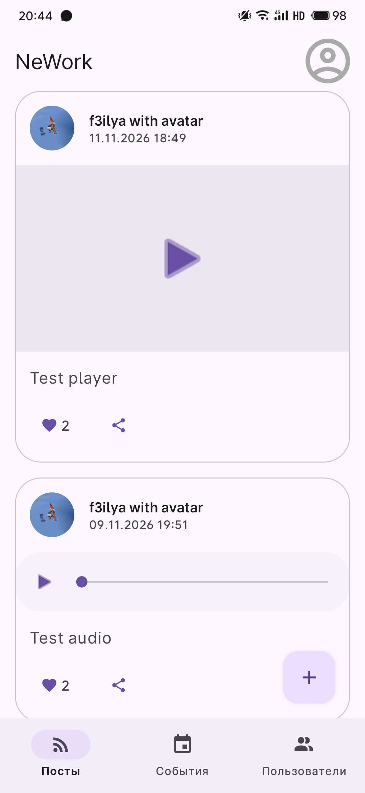
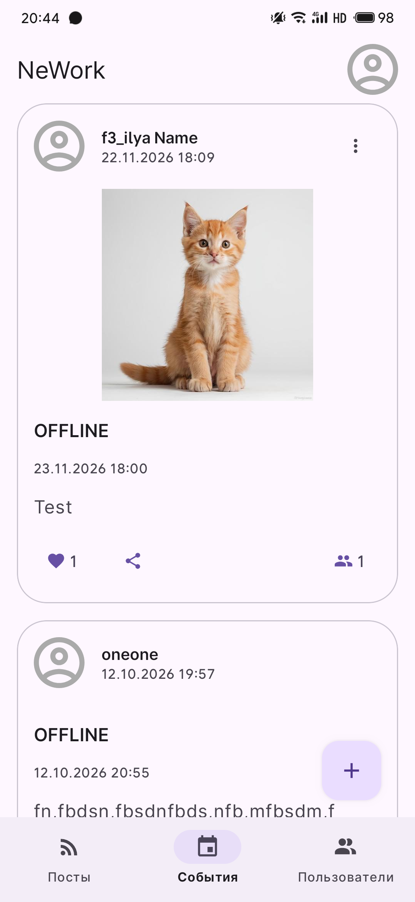
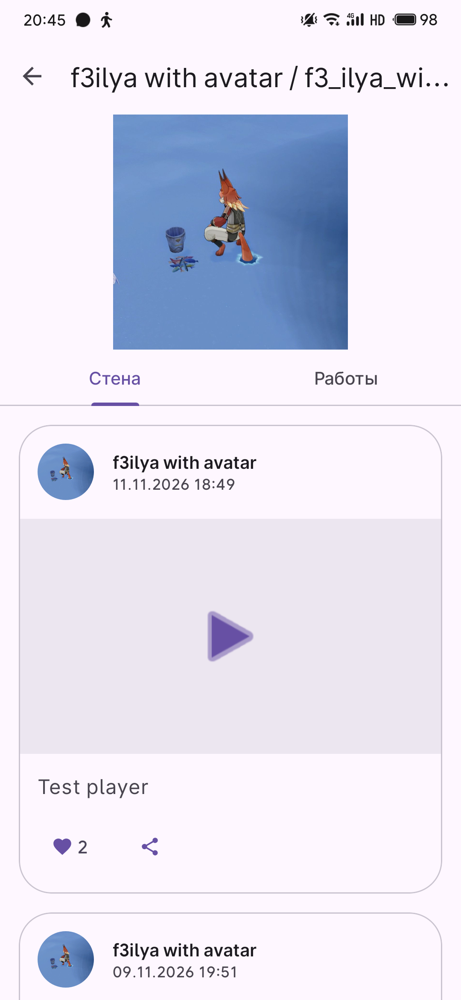
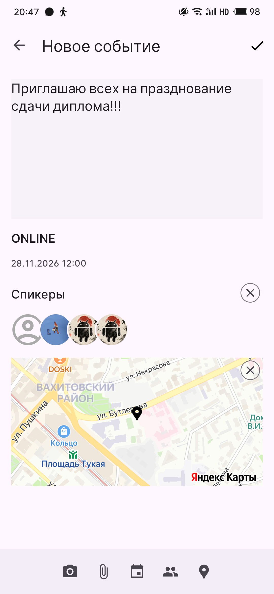
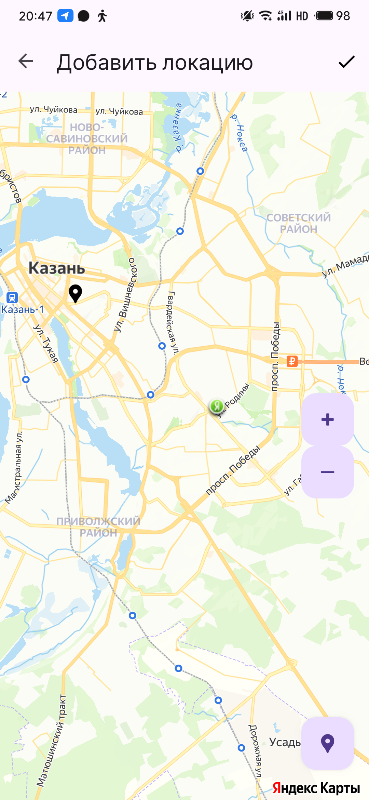

# NeWork — Социальная сеть для профессионалов

**NeWork** — это мобильное Android-приложение для делового общения, поиска полезных контактов, публикации постов, организации мероприятий и ведения профессиональной биографии. Разработано в качестве дипломного проекта на Kotlin с соблюдением принципов Clean Architecture и MVVM.

---

## 📱 Скриншоты

| Лента постов | События | Профиль пользователя | Создание контента | Карта |
| :---: | :---: | :---: | :---: | :---: |
|  |  |  |  |  |

---

## ✨ Основной функционал

* **Авторизация и регистрация:** вход в аккаунт, создание нового профиля с загрузкой аватара (с камеры или из галереи).
* **Лента постов:** бесконечная прокрутка (пагинация), лайки, репосты, прикрепление фото, аудио, видео и геометок, отметка других пользователей.
* **Мероприятия (Events):** бесконечная прокрутка (пагинация), лента онлайн и офлайн событий, запись в участники, список спикеров, отображение даты проведения и локации на карте.
* **Мультимедиа плеер:** встроенное воспроизведение аудиозаписей (с перемоткой по `SeekBar`) и видеороликов прямо в ленте и на детальных экранах с автоматическим управлением жизненным циклом.
* **Интерактивные карты:** просмотр мест проведения событий и геометок постов, выбор точки на карте с поддержкой геолокации пользователя.
* **Профиль и карьера:** просмотр своей и чужих страниц со сворачивающейся шапкой, личной стеной постов (`Wall`) и списком мест работы (`Jobs`) с указанием периода и ссылки на компанию.
* **Офлайн-режим и Single Source of Truth (SSOT):** все сетевые ответы сохраняются в локальную базу данных Room, которая выступает единственным источником данных для UI. Это обеспечивает мгновенный отклик интерфейса, работу без интернета, поддержку Pull-to-Refresh и централизованную типизированную обработку ошибок.

---

## 🛠 Технологический стек

* **Язык:** Kotlin
* **Архитектура:** MVVM, Single Activity, Clean Architecture (Repository pattern, Single Source of Truth, Unidirectional Data Flow)
* **Асинхронность и реактивность:** Kotlin Coroutines, Flow (`StateFlow`, `SharedFlow`)
* **Внедрение зависимостей (DI):** Dagger Hilt
* **Сеть:** Retrofit 2, OkHttp 3 (Logging Interceptor), Gson
* **Локальная база данных:** Room (SQLite)
* **Пагинация:** Jetpack Paging 3 (`RemoteMediator`, `PagingDataAdapter`)
* **Навигация:** Jetpack Navigation Component + SafeArgs
* **UI и верстка:** Material Design 3, ViewBinding, ConstraintLayout, CoordinatorLayout, ViewPager2 + TabLayout, SwipeRefreshLayout
* **Медиа и изображения:** AndroidX Media3 (ExoPlayer), Glide, ImagePicker
* **Карты:** Yandex MapKit SDK
* **Контроль памяти:** LeakCanary (отслеживание утечек в debug-сборке)

---

## 🧭 Структура экранов (Фрагменты)

Приложение построено по паттерну **Single Activity** (`AppActivity`) с нижней навигацией (`BottomNavigationView`):

### Основные вкладки
* **`PostsFragment`** — главная лента постов с пагинацией, воспроизведением медиа и переходами к авторам и деталям.
* **`EventsFragment`** — лента предстоящих и прошедших мероприятий с возможностью присоединиться к участию в один клик.
* **`UsersFragment` / `DetailedUsersListFragment`** — универсальный экран списка пользователей. Работает в нескольких режимах (`FragmentMode`): общий список людей, лайкнувшие, упомянутые, участники, спикеры, а также режим мультивыбора при создании поста или события.

### Детальные экраны и профиль
* **`DetailedPostFragment`** — подробный просмотр поста: полный текст, медиаплеер, статичная карта с меткой, стеки аватарок лайкнувших и упомянутых пользователей.
* **`DetailedEventFragment`** — подробный просмотр события: формат (`ONLINE`/`OFFLINE`), дата и время, спикеры, участники, лайки и карта проезда.
* **`DetailedUserFragment`** — экран профиля пользователя (своего или чужого) на базе `CoordinatorLayout` и `ViewPager2`, объединяющий две вкладки:
  * **`WallFragment`** — личная стена публикаций пользователя.
  * **`JobsFragment`** — хронология мест работы с возможностью добавления и удаления записей (для владельца профиля).

### Создание и редактирование контента
* **`NewPostFragment`** — создание и редактирование поста: ввод текста, прикрепление изображений/аудио/видео с предпросмотром, выбор упомянутых людей и координат.
* **`NewEventFragment`** — создание и редактирование мероприятия с выбором спикеров, медиавложений и локации.
  * **`EventBottomSheet`** — модальная шторка (`BottomSheetDialogFragment`) для выбора формата мероприятия и даты/времени через `MaterialDatePicker` и `MaterialTimePicker`.
* **`NewJobFragment`** — форма добавления нового места работы (название компании, должность, ссылка, даты начала и окончания).
* **`MapFragment`** — полноэкранная Яндекс.Карта для выбора координат по тапу, зумирования и перехода к текущей геопозиции пользователя.

### Авторизация
* **`AuthenticationFragment`** — экран входа по логину и паролю.
* **`RegistrationFragment`** — экран регистрации нового пользователя с установкой фото профиля.

---

## 🚀 Сборка и запуск проекта

Для работы приложения необходимы API-ключ **Yandex MapKit** и API-ключ от компании **Нетология**:

1. Клонируйте репозиторий:
   ```bash
   git clone https://github.com
   ```
2. Получите бесплатный ключ MapKit SDK в [Кабинете разработчика Яндекса](https://yandex.ru).
3. Добавьте ключ в файл `maps.properties` в корне проекта:
   ```properties
   MAPS_API_KEY=ваш_ключ_яндекс_карт
   ```
4. Получите API-ключ у компании [Нетология](https://netology.ru)
5. Добавьте ключ в файл `api.properties` в корне проекта:
   ```properties
   API_KEY=ваш_api_ключ
   ```
6. Откройте проект в **Android Studio**, дождитесь синхронизации Gradle и запустите конфигурацию `app` на устройстве или эмуляторе (Android 8.0+ / API 26+).
